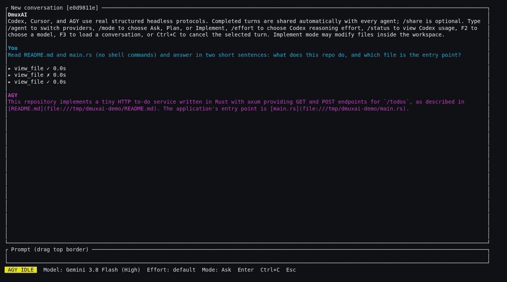
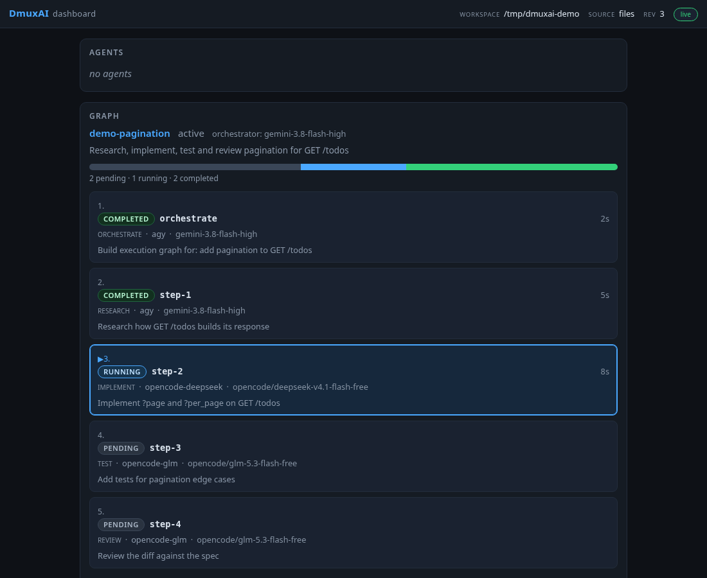
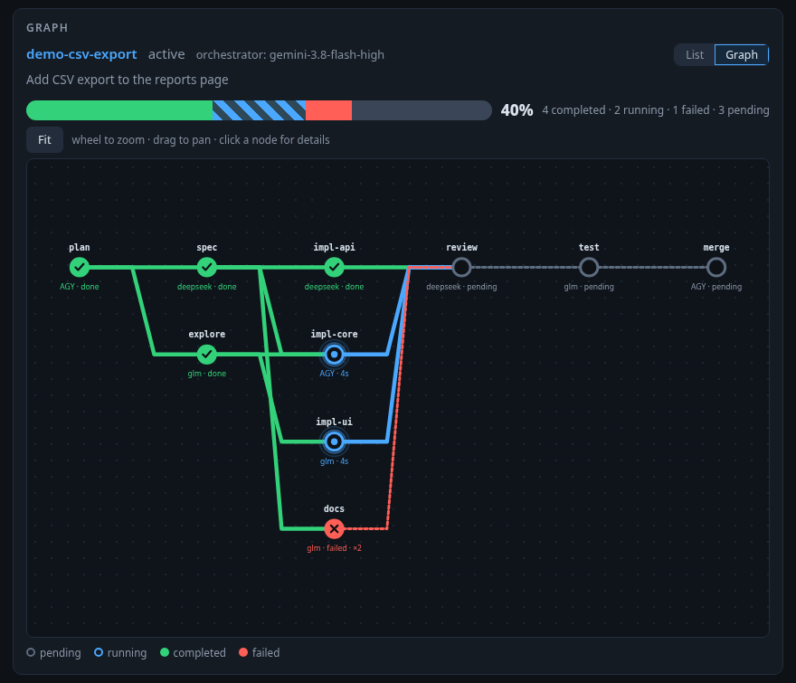
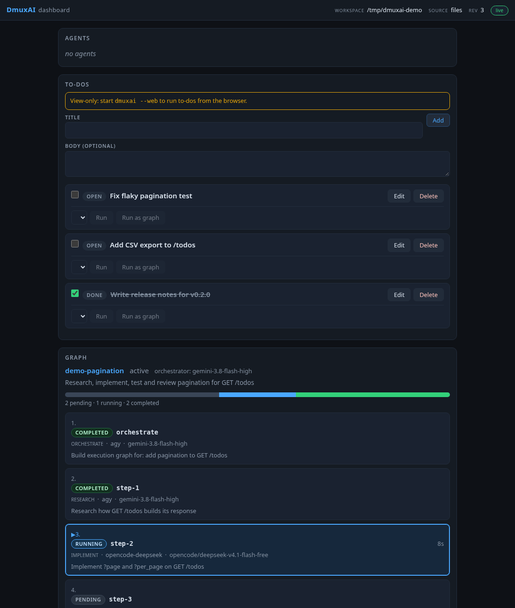
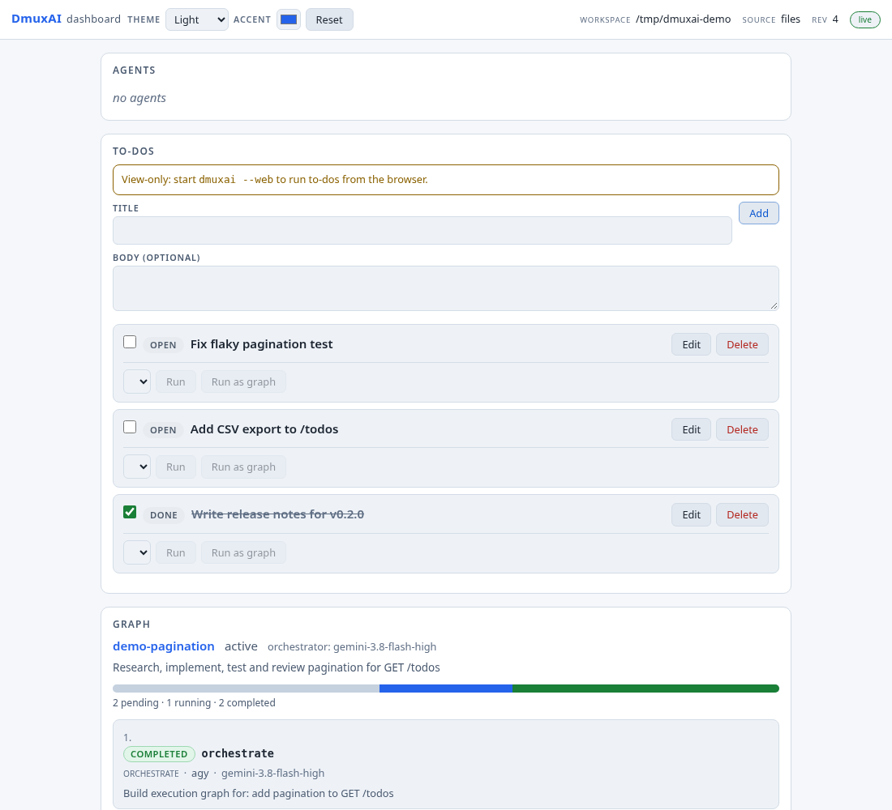
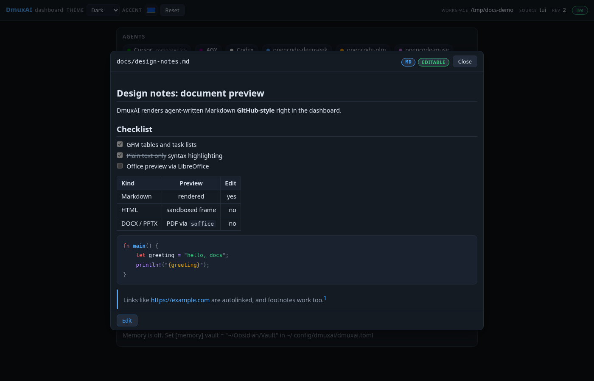
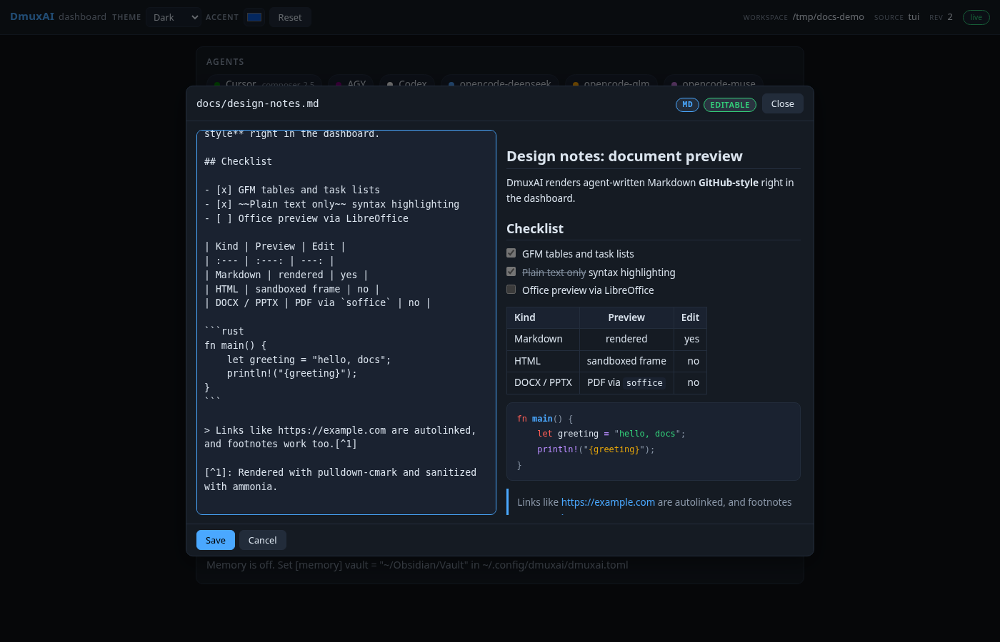
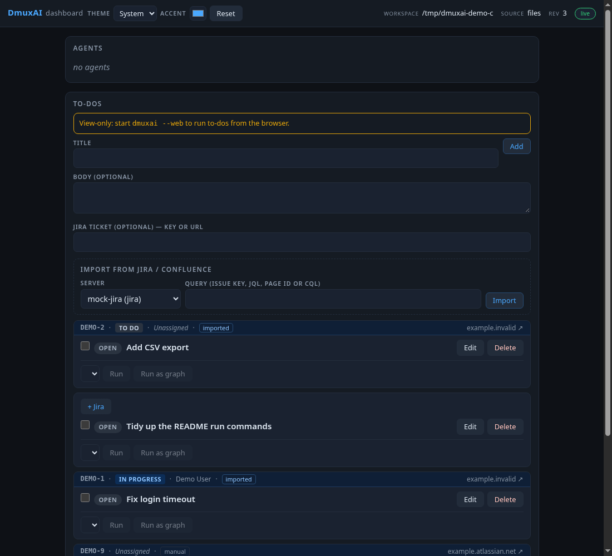

# DmuxAI

One terminal. Multiple AI coding agents.

Product direction and model policy: see [MISSION.md](MISSION.md) (primary CLIs: **cursor-agent** then **agy**; graph workflows use **composer-2.5** only).

DmuxAI is a Ratatui client for three real, structured, headless coding-agent
CLIs. It does not scrape ANSI terminal screens and does not assemble prompts
into shell commands.

| Agent | Transport | Conversation continuity |
| --- | --- | --- |
| Codex | `codex app-server --stdio` JSONL | durable `thread_id` + `thread/resume` |
| Cursor | `--print --output-format stream-json` NDJSON | durable `session_id` + `--resume` |
| AGY | stream-json input/output NDJSON | durable `conversation_id` + `--conversation` |

## What it looks like

TUI (`dmuxai` in a project directory; here AGY answering in Ask mode):



Web dashboard (`dmuxai --web` for TUI + dashboard, or `dmuxai serve` view-only).
From the top: the Chat panel (same session as the TUI), agents, to-dos,
documents changed by agents, the live graph run as a subway map, and memory.
The graph in this shot is demo data and the token is redacted:



```bash
cd /path/to/project
dmuxai                          # TUI
dmuxai -C /path/to/project      # run in /path/to/project from any directory (also --workspace-dir DIR)
dmuxai --web                    # TUI + local dashboard; the URL with its access token is shown as a notice
dmuxai serve                    # dashboard only (no TTY needed); prints: dmuxai dashboard: http://127.0.0.1:7420/?token=...
dmuxai serve --port 0           # pick a free port
```

You can also set a default workspace and extra dashboard browse roots in your
user config (`~/.config/dmuxai/dmuxai.toml`; precedence is `-C` /
`--workspace-dir`, then `DMUXAI_WORKSPACE`, then user-config `[workspace] dir`,
then the current directory):

```toml
[workspace]
dir = "~/projects/my-repo"
browse_roots = ["~/projects", "/srv/repos"]
```

In `dmuxai --web`, click the `workspace` path in the dashboard header to validate
or browse directories and switch the running session to another workspace.

The dashboard binds `127.0.0.1` only and needs the per-start token printed at
startup; other origins/hosts are rejected. Binding elsewhere requires
`--bind ADDR --allow-remote` and prints a warning. On Windows, run DmuxAI inside
WSL and open the printed URL in the Windows browser (`localhost` is forwarded).
Details: [SPEC-web-dashboard](docs/specs/SPEC-web-dashboard.md).

### Graph view



A graph run can be shown as a subway map instead of the step list (the
**List / Graph** toggle is remembered per browser). Stations are laid out left
to right by dependency depth, parallel nodes are stacked in the same column,
and lines run from each dependency to its dependent. Completed stations show a
check, failed ones a cross, the running station pulses (no animation with
reduced motion), and pending ones are hollow. The bar on top shows overall
progress; an ETA appears only when it can be computed from real node timings.
Click a station (or focus it and press Enter) for its runner, model, status,
attempt, elapsed time, job, last output lines, and changed files. Use the
mouse wheel to zoom, drag to pan, and **Fit** to reset. It updates live and
also works in `dmuxai serve`.

### To-do board



The dashboard also keeps a per-project to-do list (stored in the project's
DmuxAI database, so it survives restarts). Add, edit, check off or delete
to-dos in the browser, then send one to an agent (`Run` with an agent picked)
or through the graph planner (`Run as graph`). The to-do shows `running` while
the turn or graph runs, becomes `done` when it completes, and returns to
`open` with the error if it fails or is cancelled. Runs are refused while the
agent is busy or another graph is active, and they respect
`[graph] allowed_runners` and the agent's current mode.

`dmuxai serve` is view-only: you can manage to-dos but the run buttons are
disabled with a hint. Start `dmuxai --web` to run to-dos from the browser.

### Themes and colors



The dashboard header has a Light/Dark/System theme switcher and an accent
color picker (with a reset); both are stored in the page's `localStorage`,
`System` follows the OS preference live, and they default from the config:

```toml
[web]
theme = "dark"        # "light" | "dark" | "system" (default: system)
accent = "#3b82f6"    # #rrggbb

[theme]               # TUI surface colors
background = "#0e1116"
foreground = "#dbe4ee"
border = "#232d3c"
accent = "#4aa8ff"

[theme.agents]        # text color per agent, custom agents included
opencode-glm = "#ff8800"
codex = "magenta"
```

Colors accept `#rrggbb` or the named terminal colors; invalid values become
config warnings and the built-in default is used. `NO_COLOR` (without
`force_color = true` or `DMUXAI_FORCE_COLOR=1`) keeps colors off. The
dashboard reuses the `[theme.agents]` agent colors for its agent chips.
Details: [SPEC-theme-colors](docs/specs/SPEC-theme-colors.md).

### Document preview and editing

The dashboard's Documents panel lists the workspace files (`GET /api/docs`),
shows a "Changed by agents" feed of what each agent turn created, modified or
deleted, and opens a preview pane (also directly via `#doc=<path>` links in
agent output). Markdown is rendered GitHub-style (tables, task lists, footnotes,
code highlighting) and is editable in a split view with live preview; plain
text, JSON, YAML, TOML, CSV and code files are editable in a plain editor. Save
uses a hash-based check, so a stale editor answers with a conflict offer to
reload or overwrite. Saved access is what the server grants in `dmuxai --web`.

HTML files are preview-only in an intentionally sandboxed frame (no scripts),
Office files (`docx`, `pptx`, `xlsx`, ...) are converted to PDF for preview
through LibreOffice (`soffice`; without it only a download is offered), and
binary files are download-only. `dmuxai serve` is read-only: editing is hidden
with a hint to start `dmuxai --web`. Details:
[SPEC-docs-preview](docs/specs/SPEC-docs-preview.md).





In the TUI, workspace file paths in agent output are OSC 8 hyperlinks; a plain
left click opens the dashboard preview when `--web` runs, else the OS opener.

## Obsidian memory

DmuxAI can keep durable notes in an Obsidian vault and prepend them to every
agent's prompt (Cursor, AGY, Codex, opencode and any custom agent, graph
nodes included). It uses the same layout as the cursor-atomic-workflow
memory, so an existing `cursor-workflow/memory` folder works as is.

```toml
# ~/.config/dmuxai/dmuxai.toml (or the repo's dmuxai.toml, which wins per key)
[memory]
vault = "~/Obsidian/Vault"       # an existing directory; memory is off without it
dir = "cursor-workflow/memory"   # default; relative to the vault, no ".."
# project = "my-repo"            # default: the workspace folder name
# inject = false                 # keep saving/searching, stop prompt injection
```

```text
<vault>/cursor-workflow/memory/
  human.md                 # about you
  projects/<project>.md    # this repo
  decisions/<name>.md
  gotchas/<name>.md
  queue/proposals.json     # agent proposals waiting for approval
```

Each note is one line, `- [YYYY-MM-DD] text` (at most 200 characters). Text
that looks like a password, token, API key or private key is refused. The
injected `<memory>` block is limited to 3000 characters (900 per section),
and it is only re-sent on a resumed session when it changed.

- **Save:** `/remember <text>` in the TUI (project note), or
  `/remember --human <text>`, `--decision <name> <text>`,
  `--gotcha <name> <text>`; or the Save button in the dashboard Memory panel.
- **Approve:** agents can only *propose* notes. Review them with `/memory`,
  then `/memory approve <id>` or `/memory reject <id>`, or use the
  Approve/Reject buttons in the dashboard.
- **MCP:** `dmuxai mcp-memory` is a stdio MCP server with `memory_search`,
  `memory_get_context` and `memory_propose`. When `[memory]` is set, DmuxAI adds
  it to the shared MCP list automatically as `dmuxai-memory` (command = the
  running DmuxAI executable, args `mcp-memory --workspace <repo>`), so every
  runner, the dashboard and `/api/mcp/servers` see it. The entry holds no vault
  path or secrets; the subcommand reads `[memory]` from the workspace.

  To override it, add an entry with the same name. To disable it, add
  `enabled = false` under that name (it is not re-added). A configured entry
  with that name suppresses the automatic one even if it is invalid; the
  config warning explains why.

  ```toml
  # Replace the automatic entry with your own command
  [[mcp.servers]]
  name = "dmuxai-memory"
  command = "/opt/dmuxai/bin/dmuxai"
  args = ["mcp-memory", "--workspace", "/path/to/repo"]

  # Or turn it off
  [[mcp.servers]]
  name = "dmuxai-memory"
  enabled = false
  ```

  Standalone use: `dmuxai mcp-memory --workspace DIR`, or override with
  `--vault PATH --dir DIR --project NAME`.

Details: [SPEC-obsidian-memory](docs/specs/SPEC-obsidian-memory.md).

## Calling dmuxai from an agent

DmuxAI is usable without the terminal, from the repo it runs in. `--json` keeps
stdout machine-readable and sends diagnostics to stderr:

```bash
dmuxai status --json                                  # agents, to-dos, last graph, last event seq
dmuxai run "summarize this repo" --agent agy --json   # one-shot; add --graph for the planner
dmuxai todo add "Write docs" --body "API.md first"
dmuxai events --follow --json                         # tail .dmuxai/events.jsonl
```

MCP over stdio exposes the same operations as tools; most clients take a
command/args pair:

```json
{ "command": "dmuxai", "args": ["mcp"], "cwd": "<repo>" }
```

The server works on the repo named by `DMUXAI_WORKSPACE`, or on its working
directory when that is unset. Claude Desktop has no `cwd` field, so pass the
repo explicitly. These configs are **not yet tested with Claude Desktop
itself**. `dmuxai mcp` was checked with a raw stdio JSON-RPC session:
`initialize` and `tools/list` (`todo_add`, `todo_list`, `run`, `status`,
`events_since`) both answer.

Claude Desktop on Linux (`claude_desktop_config.json`):

```json
{
  "mcpServers": {
    "dmuxai": {
      "command": "dmuxai",
      "args": ["mcp"],
      "env": { "DMUXAI_WORKSPACE": "/home/<user>/repo" }
    }
  }
}
```

Claude Desktop on Windows, calling dmuxai inside WSL (`--cd` sets the repo):

```json
{
  "mcpServers": {
    "dmuxai": {
      "command": "wsl.exe",
      "args": ["-d", "Ubuntu", "--cd", "/home/<user>/repo", "--", "dmuxai", "mcp"]
    }
  }
}
```

`wsl.exe ... -- dmuxai` does not run your shell profile. If `dmuxai` (for
example `~/.local/bin`) or the agent CLIs and their environment variables are
only set up in `~/.bashrc` or `~/.profile`, run it through a login shell
instead: `"args": ["-d", "Ubuntu", "--cd", "/home/<user>/repo", "--", "bash",
"-lc", "dmuxai mcp"]`.

To drive a dashboard that is already running, read the discovery file it writes
(`.dmuxai/web.json`: `base_url`, `port`, `pid`, `token`) and call the
token-authenticated HTTP API:

```bash
TOKEN="<token from .dmuxai/web.json>"
curl -s -H "Authorization: Bearer $TOKEN" "http://127.0.0.1:7420/api/state"
```

With `dmuxai --web` the dashboard's Chat panel does everything the TUI does:
prompt box (Enter sends, Shift+Enter adds a line), streaming transcript,
agent/mode/model/effort pickers, every slash command (buttons or Ctrl+K), cancel,
new/load conversation and share. Agents can drive the same actions through
`POST /api/command`.

Full reference: [docs/API.md](docs/API.md) — CLI, HTTP, MCP, events and `[notify]`.

## Attach any agent CLI

Built-in runners are Cursor (`cursor-agent`), AGY and Codex. **Any other headless
agent CLI** (opencode, hermes, pi, Claude Code, ...) is attached with an
`[[agents.custom]]` block in `dmuxai.toml` (repo) or `~/.config/dmuxai/dmuxai.toml`
(user) — no Rust code. Custom agents show up in `/agent` and F2, keep conversation
continuity via their session id, and can run graph nodes:

```toml
[[agents.custom]]
name = "opencode-glm"
command = ["opencode", "run", "--format", "json", "-m", "{model}", "--dir", "{workspace}", "{prompt}"]
default_model = "opencode/glm-5.3-flash-free"
output = "jsonl"
text_path = "/part/text"
text_when = { path = "/type", equals = "text" }
session_id_path = "/sessionID"
resume_arg = ["--session", "{session_id}"]

[graph]
allowed_runners = ["agy", "opencode-glm"]   # restrict which runners graph nodes may use
```

More fields and ready-made presets: [docs/agents/custom-agents.md](docs/agents/custom-agents.md),
[docs/agents/presets.toml](docs/agents/presets.toml).

## Shared MCP servers (all agents)

Define MCP servers once under `[[mcp.servers]]` in `~/.config/dmuxai/dmuxai.toml`
(user). A repo `dmuxai.toml` overrides an entry with the same `name`, and
`enabled = false` removes it from the merged list. DmuxAI hands every runner the
merged list per run in that CLI's own native form — it never edits user-owned
agent config files. Secrets are env var names only (`{ env = "VAR" }`); values
are never stored, logged, or shown by the dashboard, and a missing env var
disables that server with a warning.

```toml
[[mcp.servers]]
name = "everything"                  # stdio transport
command = "npx"
args = ["-y", "@modelcontextprotocol/server-everything"]

[[mcp.servers]]
name = "atlassian"                   # example config only: DmuxAI never
url = "https://mcp.atlassian.com/v1/mcp"   # connects to anything on its own;
kind = "jira"                        # this is the remote Atlassian MCP over
headers = { Authorization = { env = "ATLASSIAN_MCP_AUTH" } }   # streamable HTTP
```

Optional per entry: `kind = "generic" | "jira" | "confluence"` and a `runners`
allow-list (absent = every runner):

```toml
runners = ["codex", "opencode-glm"]
```

How each runner receives the servers (all per run, nothing persisted into
agent-owned config):

| Runner | How DmuxAI passes MCP servers |
| --- | --- |
| opencode | merged into the per-run `OPENCODE_CONFIG` temp file under `mcp` (`type: local` / `remote`) |
| Codex | per-run `-c mcp_servers.<name>.command/args` (or `.url`) overrides; secret values go into the Codex child's environment and are referenced by name (`env_vars`, `env_http_headers`), never placed in argv |
| Custom agents | a per-run `{"mcpServers":{...}}` JSON file via the `{mcp_config}` placeholder + `DMUXAI_MCP_CONFIG` env var, removed after the turn |
| Cursor | writes `.cursor/mcp.json` for the run only if that file does not exist and removes it after the turn; if it exists, one notice instead |
| AGY | DmuxAI only prints the equivalent `agy mcp add` commands; AGY's user-level config is never modified |

The dashboard's own MCP client uses the same list: with a `kind = "jira"` or
`"confluence"` server configured, the to-do board shows an Import form that
pulls issues or pages into to-dos (read-only; re-importing updates instead of
duplicating). Details and the runner matrix:
[SPEC-web-dashboard](docs/specs/SPEC-web-dashboard.md).

The MCP client never follows HTTP redirects (so auth headers cannot leak to
another host), runs stdio servers in their own process group and kills the
whole group on timeout or exit, and bounds every request with a timeout.

### Jira links on to-dos

Set a base URL once and a to-do can carry a Jira ticket:

```toml
[todo]
jira_base_url = "https://example.atlassian.net"
```

Type a key such as `PROJ-123` in the add form's **Jira ticket** field and the
link becomes `https://example.atlassian.net/browse/PROJ-123`; paste a full
Jira URL and the key is extracted. Linked cards get a thin ticket strip on
top (key link, status chip, assignee or Unassigned, imported/manual tag, link
host); cards without a link show a dashed **+ Jira** button. Only `http`/`https`
links are accepted (validated on the server) and they open in a new tab with
`rel="noopener noreferrer"`. Importing Jira issues over MCP fills the key,
link, status, and assignee, and re-importing updates the card instead of
duplicating it. The screenshot below uses the built-in mock MCP server and
fake fixture data only.



## Requirements

The Windows release installer does not require Rust, Cargo, or Git. It installs
the DmuxAI executable only; coding-agent CLIs remain independently installed and
authenticated tools.

- Codex CLI, authenticated with `codex login`
- Cursor Agent CLI, authenticated with `cursor-agent login`
- AGY CLI with a working account/configuration

Installed CLI status can be checked with:

```powershell
codex --version
codex login status
cursor-agent --version
cursor-agent status
agy --version
agy models
opencode --version
claude --version
pi --version
```

## Install and run in any project

### Windows

Install the latest published Windows release for the current user. No
administrator permissions are required. The installer downloads the release,
verifies its SHA-256 checksum, installs `dmuxai.exe` to
`%LOCALAPPDATA%\DmuxAI\bin`, and adds that directory to the user `PATH`.

PowerShell:

```powershell
irm https://raw.githubusercontent.com/donggrri/dmuxai/main/install.ps1 | iex
```

Or, after cloning the repository, run `install.cmd` from Command Prompt or
`install.ps1` from PowerShell. These use the same published release; they do
not build from source.

```cmd
cd C:\path\to\DmuxAI
install.cmd
```

At the end of installation, DmuxAI reports whether Codex, Cursor Agent, AGY,
OpenCode, Claude Code, and Pi are available on `PATH`. Missing tools do not
prevent DmuxAI from installing. To omit that report, run
`./install.ps1 -SkipProviderCheck`.

Then move to any project and run `dmuxai` with no path argument:

```powershell
cd C:\path\to\project
dmuxai
```

DmuxAI uses the folder from which it was started as its workspace, so its agents
operate on that project. To update it, run the installer again; it replaces the
current-user executable with the latest published release.

You can start multiple DmuxAI windows from the same project at the same time.
When another live DmuxAI window already owns that workspace, a new window
starts in its own conversation and provider processes; the existing workspace
conversation list remains available from `/conversations` or `F3`.

### Build from source

Rust and Cargo are required only when building from source:

```powershell
cargo install --path . --locked --force
```

Conversations remain scoped by the canonical project path.

## First run

DmuxAI needs no configuration to start. Run `dmuxai` in a project folder:

- **Built-in runners:** Cursor (`cursor-agent`), AGY (`agy`) and Codex (`codex`)
  are always offered. Each needs its own CLI installed and signed in.
- **opencode:** when the `opencode` executable is on `PATH` (or
  `DMUXAI_OPENCODE_BIN` names one), DmuxAI adds an `opencode` runner. It follows
  the free-model policy: only models matching `^opencode/.*-free$` are offered,
  and the first one listed by `opencode models` is used by default. If the
  listing fails, times out after 10 seconds, or has no free model, the runner
  still appears, and choosing it or sending a prompt shows the policy message.
  The built-in opencode runner takes no graph nodes unless you list `opencode`
  in `[graph] allowed_runners`.
- **Override:** an `[[agents.custom]]` entry named `opencode` in `dmuxai.toml`
  replaces the built-in runner with your own command and model policy.
  `[agents] builtin_opencode = false` hides it.
- **grok:** when `grok` is on `PATH`, `DMUXAI_GROK_BIN` names an existing file,
  or `~/.grok/bin/grok` is executable, DmuxAI adds a `grok` runner. Models must
  match `grok-*` and must not contain `fast`. The default is `grok-4.7`. A
  logged-out CLI still lists the runner, and choosing it or sending a prompt
  asks you to run `grok login`. `[agents] builtin_grok = false` hides it. An
  `[[agents.custom]]` entry named `grok` replaces the built-in runner. The
  built-in grok runner takes no graph nodes unless you list `grok` in
  `[graph] allowed_runners`.

To start from a commented config that lists the runners it detected:

```bash
dmuxai init                # user config: ~/.config/dmuxai/dmuxai.toml
dmuxai init --workspace    # ./dmuxai.toml, for this project only
```

`dmuxai init` refuses to overwrite an existing file unless you add `--force`.
It prints the path it wrote and the runners it found on `PATH`.

## Linux / WSL release binary

Each tagged release also has a prebuilt, statically linked (musl)
`dmuxai-linux-x86_64.tar.gz` that runs on any x86_64 Linux distro, including
WSL. Download it and check the checksum:

```bash
curl -LO https://github.com/donggrri/dmuxai/releases/latest/download/dmuxai-linux-x86_64.tar.gz
curl -LO https://github.com/donggrri/dmuxai/releases/latest/download/dmuxai-linux-x86_64.tar.gz.sha256
sha256sum -c dmuxai-linux-x86_64.tar.gz.sha256
```

The archive keeps one top directory, so it does not scatter files into the
current folder. It extracts to `dmuxai-linux-x86_64/{dmuxai,README.md,CHANGELOG.md}`.
Extract it, then install the binary into `~/.local/bin`:

```bash
mkdir -p ~/.local/bin
tar xzf dmuxai-linux-x86_64.tar.gz
install -m 0755 dmuxai-linux-x86_64/dmuxai ~/.local/bin/dmuxai
```

Or do both in one step, without leaving the extracted directory behind:

```bash
mkdir -p ~/.local/bin
tar -xzf dmuxai-linux-x86_64.tar.gz -C ~/.local/bin --strip-components=1 dmuxai-linux-x86_64/dmuxai
```

If `~/.local/bin` is not on your `PATH`, add it, for example in `~/.bashrc`:

```bash
export PATH="$HOME/.local/bin:$PATH"
```

Then check the install:

```bash
dmuxai --version
```

## Run from source

Windows PowerShell:

```powershell
cd C:\path\to\DmuxAI
cargo run

# Open another project without changing directories (the workspace is
# DMUXAI_WORKSPACE, or the current directory when it is unset):
$env:DMUXAI_WORKSPACE = 'C:\path\to\project'; cargo run
```

Linux shell:

```bash
cd /path/to/DmuxAI
cargo run

# Open another project without changing directories:
DMUXAI_WORKSPACE=/path/to/project cargo run
```

Controls:

- Type or paste: edit the prompt
- `/image <path>` or paste a single image path (`png`, `jpg`, `webp`, max 10 MiB each): attach files for the next prompt; attachments appear in the prompt title bar
- `Backspace`: delete the previous character
- `Enter`: send to the selected agent
- Type `/`: preview matching slash commands; use `Up` / `Down` and `Enter` or `Tab`
- `/agent`: open the active-agent picker, then use `Up` / `Down` and `Enter`
- `/mode`: choose `Ask`, `Plan`, or `Implement` for the active agent; Cursor Implement is unavailable on Windows
- `/effort`: choose a supported Codex reasoning effort for later turns
- `/status`: show Codex model/effort plus available token activity and rate limits
- `/new [title]`: create and switch to a durable conversation
- `/conversations` or `F3`: list and load conversations for the current workspace
- `/resume <id-prefix>`: load one conversation by a unique ID prefix
- `/summarize`: compress the completed shared context for the selected agent
- `/share <codex|cursor|agy>`: optionally replay a context import to one agent; ordinary turns are shared automatically
- `/quit`: stop owned child processes, restore the terminal, and exit
- `F2`: load and open that agent's model picker
- Model picker `Up` / `Down`, `Enter`, `Esc`: move, select, or close; on Codex,
  `Tab` selects the highlighted model and opens its effort picker
- Mouse wheel: scroll the chat history without changing the active agent
- Drag across Chat text: highlight and copy the selected text to the system clipboard
- Drag the prompt pane's top border: resize the chat/prompt height ratio
- `Ctrl+C`: cancel the selected agent's active turn
- `Esc`: close an open picker or slash preview; otherwise keep the application running

`/agent` changes which adapter receives the next prompt. Within a DmuxAI
conversation, each provider keeps its own native thread/session binding, while
completed turns are automatically projected into the next request for every
agent. Merely switching agents no longer requires `/share`; the command remains
available only for an explicit replay when desired.
The active agent is shown in the bottom status line; the agent list appears only
inside the `/agent` picker instead of occupying a permanent sidebar.

Model catalogs are loaded lazily only when `F2` is pressed. The chosen model is
kept separately for each agent and passed to subsequent turns. A CLI can list a
model that the current account or team policy does not permit; that provider
error is shown in chat so another model can be selected.

For Codex, `/effort` loads the selected model's advertised reasoning-effort
options and applies the selected value to subsequent turns. In the model picker,
press `Tab` to choose effort for the highlighted model. Changing an idle agent's
mode retires only that agent's native session; the next prompt opens a new
mode-scoped session with DmuxAI's completed shared context. During a Codex turn,
DmuxAI shows concise transient progress for commands, MCP calls, file changes,
searches, and other supported tool items. `/status` displays provider-reported
token activity and quota windows when the current Codex authentication supports
those fields; unavailable fields are labeled rather than estimated.

DmuxAI stores the canonical transcript, turns, provider bindings, context
checkpoints, and runtime-session ownership in SQLite. When no other live window
is using the current workspace, restart restores the latest conversation and
resumes a valid provider-native session. A new window started beside a live
peer receives a fresh conversation, while all completed workspace conversations
remain selectable. If no valid native session covers the common conversation
head, DmuxAI injects the shared rolling summary and recent completed turns from
all agents into a fresh session. The full transcript is retained; summarization
only changes the bounded context projection sent to the provider.

The database is stored at `%LOCALAPPDATA%\DmuxAI\conversations.sqlite3` on
Windows, `$XDG_STATE_HOME/dmuxai/conversations.sqlite3` when `XDG_STATE_HOME` is
set, or `~/.local/state/dmuxai/conversations.sqlite3` otherwise. Conversations
are scoped by the canonical current workspace path.

## Safety and platform behavior

Every agent starts in `Ask`. Modes are kept separately per agent and apply to
subsequent turns:

| Mode | Codex | Cursor | AGY |
| --- | --- | --- | --- |
| `Ask` | read-only sandbox | `--mode ask` | plan+sandbox with a Q&A instruction |
| `Plan` | read-only sandbox with a planning instruction | `--mode plan` | `--mode plan --sandbox` |
| `Implement` | workspace-write sandbox, approvals `never` | `--force --sandbox enabled` (macOS/Linux only; unavailable on Windows) | `--mode accept-edits --sandbox` |

`Implement` is the only mode intended to modify project files. It must be
selected explicitly with `/mode`; commands remain constrained to the provider's
workspace/sandbox configuration. DmuxAI never enables Codex danger-full-access,
Cursor's unsandboxed mode, or AGY's `--dangerously-skip-permissions` flag.

Cursor Implement is unavailable on Windows because Cursor sandbox mode requires
macOS or Linux. DmuxAI rejects that mode before changing the selected mode or
starting a provider process; use Cursor Ask or Plan on Windows.

The active mode is shown in the bottom status bar and in the `/agent` picker.
Mode changes are rejected by the UI while that agent has an active turn.

Windows uses `codex.exe` and `agy.exe`. Cursor's Windows installer exposes shell
wrappers, so DmuxAI resolves the latest installed Cursor version and launches
its bundled `node.exe index.js` directly. Linux uses `codex`, `cursor-agent`,
and `agy`. Windows children receive `CREATE_NO_WINDOW`; Cursor Implement remains
disabled on Windows because its sandbox is unavailable there.

Executable overrides:

- `DMUXAI_CODEX_BIN`
- `DMUXAI_CURSOR_BIN`
- `DMUXAI_AGY_BIN`

Prompts are written to child stdin. Neither Windows nor Linux routes prompt text
through `cmd.exe`, PowerShell command strings, or `/bin/sh`.

### Cursor latency

DmuxAI adds no measurable overhead to Cursor turns; the cold start latency is `cursor-agent`'s own process startup before it reads stdin. In interactive mode (TUI and web dashboard), DmuxAI pre-starts the next `cursor-agent` process in its own process group with piped stdin while you type or review the prior response, hiding an indicative ~1.4–2.1 s of measured cold start latency (the effective reduction depends on typing and idle time between turns).

Pre-warming is enabled by default in interactive sessions and can be configured under `[cursor]`:

```toml
[cursor]
prewarm = true              # set to false to disable pre-start
prewarm_idle_secs = 300     # idle timeout in seconds before unprompted warm processes are reaped
```

## Agent graph orchestration (default)

Multi-step prompts are planned as an agent-graph-engineering DAG before any CLI
turn runs. **Every graph node uses `composer-2.5` only** (repository model policy).
Model ids containing `fast`, or any non–composer-2.5 id, are rejected. Short 1–2
step prompts skip the graph and run on the **currently selected** agent with
`composer-2.5` applied.

- Status bar shows the active graph assignment.
- `/graph` — show the current plan
- `/graph continue` — approve a merge/DB/auth gate
- `/graph override <node> <cursor\|agy\|codex> <model-id>` — override runner/model

Graph state is stored under `.dmuxai/graphs/` for resume. Skills are loaded from
`.agents/skills/*/SKILL.md` and prefixed to node prompts when bound.

Disable auto-planning in `dmuxai.toml`:

```toml
[graph]
enabled = false
max_parallel = 2
max_retries = 2
```

### Graph allowed runners and user-level config

A machine or workspace can constrain which runners are permitted to execute graph nodes with `allowed_runners`:

```toml
[graph]
allowed_runners = ["agy", "opencode"]
```

A machine can exclude `cursor` from the graph globally across all workspaces by setting `[graph] allowed_runners = ["agy", "opencode"]` in the user-level configuration:
- `$XDG_CONFIG_HOME/dmuxai/dmuxai.toml` (fallback `~/.config/dmuxai/dmuxai.toml`)

Exception: when `allowed_runners` is unset, every runner may take graph nodes
except the built-in opencode and grok runners (see [First run](#first-run)).
List `opencode` or `grok` explicitly to allow that runner.

User-level configuration is read first, and any keys in the workspace `dmuxai.toml` override user configuration per key.

## Custom headless agents

Any headless agent CLI (opencode, hermes, pi, ...) can be added via `[[agents.custom]]`
in `dmuxai.toml` — no Rust code. Custom runners appear in `/agent` and F2, keep their own
chat color, and can act as graph runners. See
[docs/agents/custom-agents.md](docs/agents/custom-agents.md) for the fields and
[docs/agents/presets.toml](docs/agents/presets.toml) for ready-made presets.

`NO_COLOR` disables chat colors unless `DMUXAI_FORCE_COLOR=1` is set.

## Image attachments

Attach `png`, `jpg`, or `webp` files (10 MiB per file) before sending a prompt:

- `/image path/to/screenshot.png`
- Paste a single filesystem path into the prompt area
- Mention supported paths in the prompt text (for example `see ./ui.png`)
- Press Ctrl+V or Alt+V with a PNG image in the clipboard

Attached files are copied under `.dmuxai/attachments/` in the workspace. Clipboard
images are saved there as `clip-<uuid>.png`. The prompt title shows `[Image #1]`
chips until the turn is sent successfully.

Cursor and AGY have no `--image` CLI flag, so their prompts carry `@<path>`
tokens appended to the prompt text; Codex keeps `@path` references in the turn
text (the app-server JSON has no separate image field in DmuxAI today).

## Verify

```powershell
cargo fmt --check
cargo test --all-targets
cargo clippy --all-targets --all-features -- -D warnings
rustup target add x86_64-unknown-linux-gnu
cargo clippy --target x86_64-unknown-linux-gnu --all-targets --all-features -- -D warnings
```

## Delivery workflow

All behavior changes follow `Spec -> Plan -> Execute -> Review -> Test`.
The current product contract and test traceability matrix are in
[docs/specs/DMUXAI-BASELINE.md](docs/specs/DMUXAI-BASELINE.md); start a new
feature from [docs/templates/FEATURE-SPEC.md](docs/templates/FEATURE-SPEC.md)
and follow [docs/WORKFLOW.md](docs/WORKFLOW.md).
Planned work and its status are on the [roadmap](docs/ROADMAP.md) (with a
GitHub milestone per release).

Real-provider smoke tests are ignored in the ordinary suite because they need
installed, authenticated CLIs and make real model requests:

```powershell
cargo test real_codex_app_server_handshake -- --ignored --nocapture
cargo test real_codex_turn_streams_to_completion -- --ignored --nocapture
cargo test real_codex_turn_can_be_interrupted -- --ignored --nocapture
cargo test real_cursor_turn_streams_to_completion -- --ignored --nocapture
cargo test real_agy_turn_streams_to_completion -- --ignored --nocapture
```

The Cursor smoke test currently names a model allowed by this development
machine's team policy. If that catalog changes, update the ignored smoke-test
model without hard-coding it into production selection behavior.

## Architecture

```text
TUI / keyboard
    -> ConversationEngine
    -> SQLite WAL: runtime_sessions / conversations / turns / messages
        -> per-process session heartbeat and turn ownership
        -> provider bindings by (conversation, agent)
        -> agent-specific summary checkpoint + recent tail
    -> bounded command mpsc (8 per agent)
        -> Codex actor
            -> persistent App Server JSONL process
        -> Cursor actor
            -> one headless NDJSON process per turn
            -> resume with provider session_id
        -> AGY actor
            -> one headless NDJSON process per turn
            -> resume with provider conversation_id
    -> bounded AgentOutput mpsc (64 shared)
    -> provider-independent AgentEvent
        -> correlated conversation/turn persistence
        -> text/model/completion/error state
        -> coalesced rendering (at most every 25 ms)
```

Each adapter owns its process and protocol-specific state. The UI sees only
normalized events. Cursor and AGY close stdin after writing one prompt so their
one-shot processes receive EOF; cancelling aborts the owning task and Tokio's
`kill_on_drop(true)` terminates the provider child. App shutdown closes all
command senders and awaits every adapter actor.

Chat autoscroll uses Ratatui's rendered-line count, so wrapped lines are included
when calculating the bottom of the viewport.

## Rust concepts for a C++ developer

### `async` / `await`

An `async fn` produces a `Future`, conceptually similar to a C++ coroutine state
machine. At `.await`, the task can suspend without blocking an OS thread. This
lets keyboard handling continue while one or more agents stream output.

### `tokio::spawn`

`tokio::spawn` schedules a lightweight task on the runtime. It resembles moving
an owning coroutine onto an executor more than creating one `std::thread` for
every operation. Its `JoinHandle` can be awaited or aborted.

### Bounded `mpsc`

Tokio's multi-producer/single-consumer channel resembles a typed, thread-safe
producer/consumer queue. Fixed capacities make backpressure explicit instead of
allowing memory to grow without limit. UI-facing methods use `try_send`, so an
overloaded runtime reports an error rather than blocking keyboard input.

### `Send`

`Send` proves that ownership of a value may safely move to another thread. It
does not mean “has a `send()` method.” Tokio may move spawned futures between
runtime workers, so values held across `.await` points normally need `Send`.

### `'static`

For `tokio::spawn`, `'static` means the future does not borrow references that
could expire while the task is alive. It does not mean the data lives forever.
The task owns its prompt, path, channel sender, selected model, and session ID,
similar to move-capturing owning C++ values in a task lambda.

## Code map

- `src/main.rs`: Tokio entry point and terminal RAII guard
- `src/app.rs`: event loop, chat rendering, routing, model picker, shutdown
- `src/conversation.rs`: durable SQLite conversations, runtime sessions, and context projection
- `src/agent/mod.rs`: provider-independent events, models, adapter interface
- `src/agent/codex.rs`: Codex App Server client
- `src/agent/cursor.rs`: Cursor NDJSON process and session adapter
- `src/agent/agy.rs`: AGY NDJSON process and conversation adapter
- `src/process/mod.rs`: Windows/Linux executable and headless-process boundary
- `src/cli.rs`, `src/agent_api.rs`: headless `run`/`todo`/`status`/`events` subcommands, JSON output and exit codes
- `src/mcp_server.rs`: `dmuxai mcp` stdio MCP server for other agents
- `src/events.rs`, `src/notify.rs`: `.dmuxai/events.jsonl` state-change log, webhooks and command hooks
- `src/graph/`: agent-graph planning and orchestration
- `src/todo.rs`: persistent per-repo to-dos
- `src/mcp/`: shared `[[mcp.servers]]` config, per-runner propagation, MCP client and registry
- `src/memory.rs`, `src/memory_mcp.rs`: Obsidian memory and the `dmuxai mcp-memory` server
- `src/theme.rs`: TUI and dashboard colors
- `src/web/`: local dashboard (`serve`/`--web`): auth, snapshot hub, HTTP/SSE routes, graph layout, parity matrix, embedded assets

Protocol references:

- [OpenAI Codex App Server](https://developers.openai.com/codex/app-server)
- [Cursor headless CLI](https://docs.cursor.com/en/cli/headless)
- [Cursor stream-json output](https://docs.cursor.com/en/cli/reference/output-format)
- [Google Antigravity headless mode](https://antigravity.google/docs/cli/headless/)

The next major step is tool/permission event normalization and richer structured
message parts beyond the current normalized text transcript.
